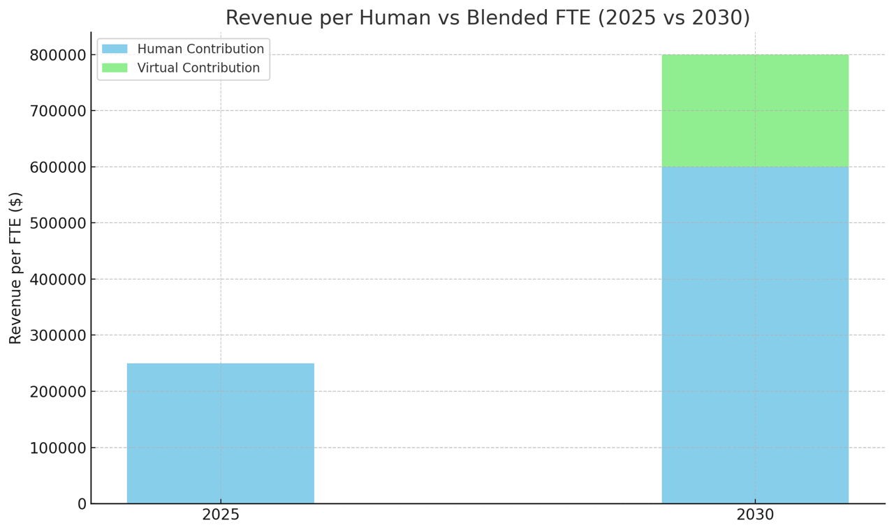

---
# Generated by scripts/export-hygraph.mjs from Hygraph. If you edit this file by hand,
# re-running the export will skip it (see scripts/hygraph-export-manifest.json).
title: "The 2030 Insurance Agency: Where Humans and Machines Build Revenue Together"
slug: "the-2030-insurance-agency-where-humans-and-machines-build-revenue-together"
description: "By 2030, the insurance agency benchmark won’t just measure human output — it will reflect the combined power of people and AI. As automation handles the busywork, the real value of your team will lie in strategic thinking, emotional intelligence, and creative problem-solving."
pubDate: "2025-04-30T15:35:33.598534+00:00"
updatedDate: "2025-04-30T15:35:33.107721+00:00"
author: "dana-coates"
categories: ["Opinion"]
tags: ["Educational"]
heroImage: "../../assets/blog/the-2030-insurance-agency-where-humans-and-machines-build-revenue-together.webp"
heroAlt: "Profile of a woman with glowing binary code projected on her face"
draft: false
hygraphId: "cma43lcnl3f9307mz6q9uvq15"
---

The Baseline: 2025 Human Layer Benchmark  
  
• $250,000 in commission revenue per employee is the commonly accepted benchmark today.  
  
• This is based on a largely human-driven process across service, sales, and admin, with varying degrees of automation layered on top (email templates, CRM reminders, policy download, etc.).  
  
• Most agencies that hit this benchmark have _some_ automation and tech support, but still rely heavily on people to move things across the finish line.  
  
Enter 2030: Human + Machine Collaboration  
  
  
By 2030, we expect:  
  
• Significantly increased tech enablement: AI bots handling quote preparation, submission writing, follow-up scheduling, renewal processing, and perhaps even coverage comparisons and customer education.  
  
• Human roles evolving into strategic, creative, and emotional intelligence roles: nurturing relationships, spotting coverage gaps creatively, solving complex problems, and mentoring less experienced staff or clients.  
  
  
This means:  
  
• Fewer humans can do much more.  
  
• The value per human should _increase_ — not just in production capacity, but in _strategic output_.  
  
• But just as important, the “non-human layer” (bots, systems, and AI workflows) will now be producing tangible value and cost savings too — and that should be factored in.  
  
  
⸻  
  
Projected Math for 2030 (Assuming AI Adoption Matures)  
  
  
Let’s say:  
  
• Each human role becomes 2x more productive through automation. (This is conservative.)  
  
• That means the benchmark would shift from $250,000 to at least $500,000 per human layer in commission revenue.  
  
• Some agency models, particularly those investing heavily in smart automation and reducing friction, might see this climb to $600,000–$750,000 per human, particularly in commercial lines and complex personal lines.  
  
• Agencies that _don’t_ evolve will fall behind in per-head revenue, not because the team is lazy or less skilled — but because they’re competing against augmented humans who are working with a fleet of bots behind them.  
  
  
⸻  
  
What About the Bots?  
  
  
Just like we budget for AMS licenses, E&O, and staff, we’ll soon:  
  
• Budget for AI agents, workflow bots, and knowledge systems.  
  
• Assign a “virtual FTE value” to each bot or AI-enabled process.  
  
• For example, if a quoting bot replaces 40% of an assistant’s time, you might treat that bot as worth $100,000 of revenue capacity, just like you would a junior account manager.  
  
  
⸻  
  
Summary:  
  
• 2025 Benchmark: $250,000 per human layer  
  
• 2030 Benchmark: $500,000–$750,000 per human layer (depending on AI leverage and complexity of business)  
  
• Virtual layer contribution: Quantified based on task replacement or acceleration, possibly contributing the equivalent of 1–2 FTEs worth of output per agency  
  
  
⸻  
  
  
The big takeaway? The real value of humans in 2030 will be based on emotional intelligence, problem-solving, trust, and strategic creativity — not just transactional processing. Bots will do the grunt work, but they can’t replace the nuance of a truly skilled agent, advisor, or account manager.
