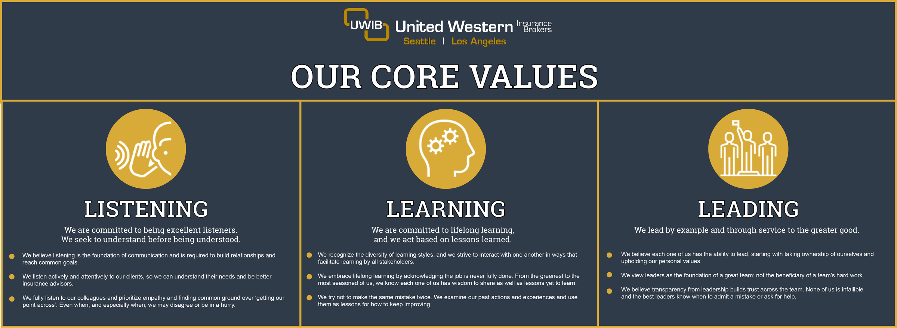

---
# Generated by scripts/export-hygraph.mjs from Hygraph. If you edit this file by hand,
# re-running the export will skip it (see scripts/hygraph-export-manifest.json).
title: "Our Values"
slug: "our-core-values"
description: null
template: "SingleColumn"
hasBody: true
headerImage: "../../assets/pages/our-core-values-header.jpg"
headerAlt: "Two businesspeople shaking hands over a desk with a laptop and paperwork"
updatedDate: "2025-02-12T22:44:21.380027+00:00"
hygraphId: "clcuv8a97kla609lj11sd8ay1"
---

We are a forward-thinking boutique agency with roots steeped in tradition. This means we offer our clients the latest in digital tools while supporting them with old-fashioned customer service.

Our culture is vital to our success. And, our Core Values are vital to building and maintaining our culture. In 2020, our team developed these values together as guideposts for how we all should treat one another, our clients, and all other partners.

